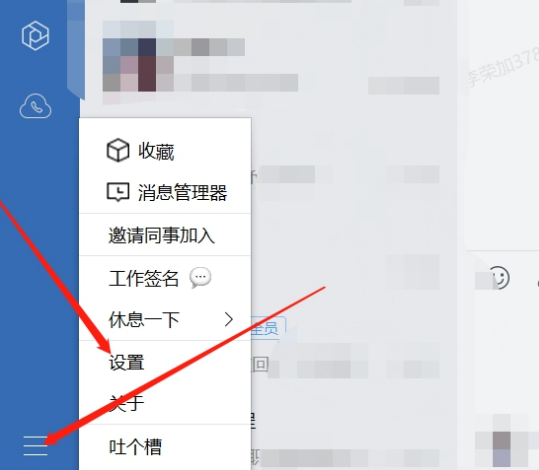
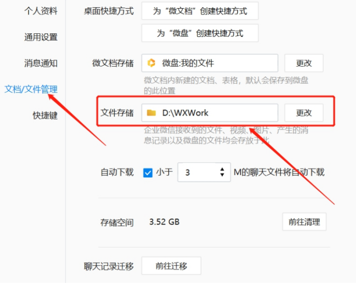
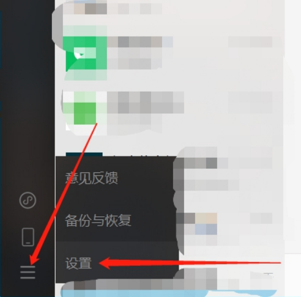
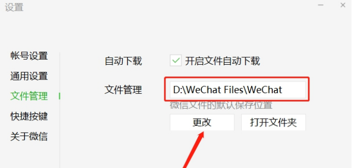

---
title: 'Windows 清理C盘空间指导'
date: "2024-04-02"
author:
  - 信息中心
output: 
  rticles::ctex:
    toc: true
# subtitle: '以 PDF 输出为例'
keywords:
  - 清理C盘空间
# abstract: >
# fontsize: "10pt"
# papersize: "a5"
# geometry: "margin=1in"
# biblio-title: 参考文献
# bibliography: skeleton.bib
# link-citations: yes
# # documentclass: ctexart

--- 

<GlobalComponent/>

### 一、企业微信聊天记录转移
#### 1、具体步骤
> 企业微信聊天记录默认存放位置是 C 盘我的文档。在其他盘比如 D 盘先新建目录，再进去企业微信设置转移。
##### 1、点击企业微信中的设置选项

##### 2、找到文档/文件管理，在文件存储选项，可设置将企业微信内容更改存储至D盘中。

### 二、微信聊天记录转移
#### 1、具体步骤
> 微信聊天记录默认存放位置是 C 盘我的文档。在其他盘比如 D 盘先新建目录，再进去微信设置转移。
##### 1、点击微信中的设置选项

##### 2、找到文件管理，在文件管理选项，可设置将微信内容更改存储至D盘中。

