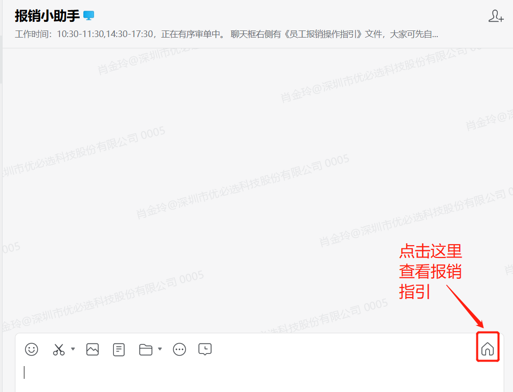
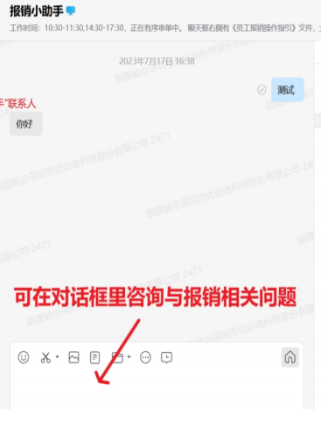
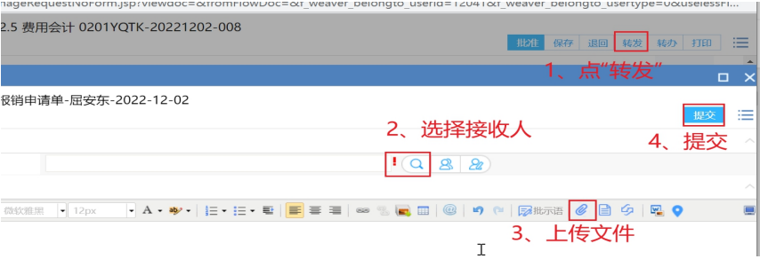
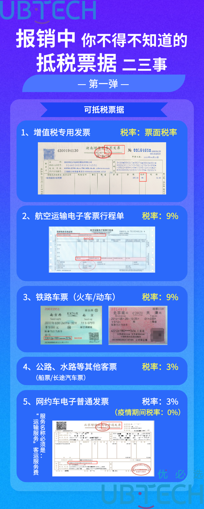
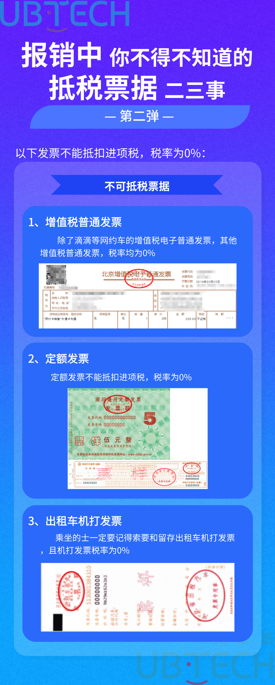
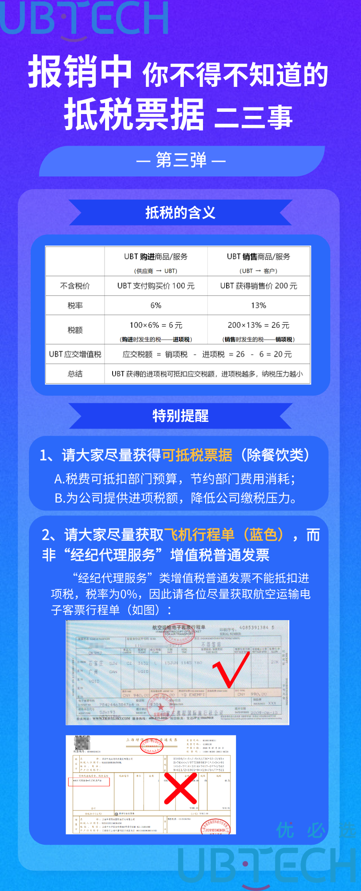

---
title: '报销问题自助解决指南 '
date: "2024-05-16"
author:
  - 信息中心
output: 
  rticles::ctex:
    toc: true
# subtitle: '以 PDF 输出为例'
keywords:
  - 报销
# abstract: >
# fontsize: "10pt"
# papersize: "a5"
# geometry: "margin=1in"
# biblio-title: 参考文献
# bibliography: skeleton.bib
# link-citations: yes
# # documentclass: ctexart

--- 
<GlobalComponent/>
### 一、查阅报销指引文档和咨询报销问题
::: tip 注意： 
报销的任何问题联系【报销小助手】或财务的同事，不要咨询IT的同事，IT不负责也不了解此业务，谢谢！
:::

进入企业微信--【通讯录】--【员工服务】--【报销小助手】,点击右侧《财务管理》按钮，然后进入浏览器即可看到已上传的财务文档，有员工报销操作指引、员工费用报销管理规范、集团各公司开票资料、集团各公司收款账号、私车公用表等 

 
### 二、出差申请流程关联、出差补贴出现问题可能原因及解决办法
可能原因： 
1、0001 出差申请流程没有归档 
2、0001 出差申请流程【费用明细】处申请预算总额已用完 
3、0201 费用报销单【费用期间】没有覆盖完整出差期间 
4、0001 出差申请流程没有转发给报销人（多人报销） 
5、0001 出差申请流程被其他人完结（多人报销） 
6、境外出差补贴计算方法有误 
解决方法： 
1、归档出差申请流程 
2、补提出差申请流程，以后申请预算注意保证所需 
3、修改费用期间使其完整覆盖出差期间 
4、在 0001 出差申请流程中将该流程转发给报销申请人 
5、找 IT 戴贤停或者龚丽帮忙重开该出差申请流程预算 
6、境外出差汇率按报销提交日计算，连续出差第一天出差补贴为 100 元人民币 
自查后非以上原因，可以联系 IT 戴贤停或者龚丽帮忙查找原因并处理 
### 三、发票 ocr 验证不通过原因
如是当天所开发票，需要等几个小时信息才会同步到税务系统，然后才能验证。 
如是以前所开发票，有虚假发票的可能，也有可能为验票系统故障，可通过以下 
网站查验发票是否有问题： 
增值税发票查验网站： 
<https://inv-veri.chinatax.gov.cn/> 
深圳电子发票查验网站： 
<https://etax.shenzhen.chinatax.gov.cn/BsfwtWeb/apps/views/fp/fpcy/fp_fpcy.html> 

### 四、税率问题
税率的选择按照能抵扣进项税额的税率填写，有时虽然票面有税率但是报销时税率应选择 0%。能抵扣进项税额的有专用发票（按照票面税率，纸质电子均可）、纸质火车票（9%）、纸质蓝色航空运输电子客票行程单（9%）、实名制纸质长途汽
车票和船票（3%）、网约车税率为 3%的增值税电子票（税率为 6%、9%的不能抵扣）、左上角带有“通行费”字样的电子高速通行费发票（3%）。注意，业务招待费（包括餐饮、交通住宿、礼品）、员工福利费、部门活动费、部门激励即使为专票也
不能抵税，税率为 0%。其他发票税率一律为 0%，具体可参见文末《附件一 抵税票据宣传资料》
### 五、在流程里面补充文件
 
### 六、关于报销款支付
如无特殊情况，出纳付款时间一般在每周三（由于需要提前进行资金储备调拨，
流程在当周周二中午 12 点前走到出纳节点的，当周会支付，否则顺延到下周三
支付）
### 附件一 抵税票据宣传资料
 
 
 

 