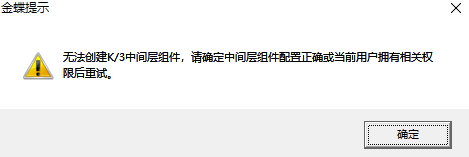
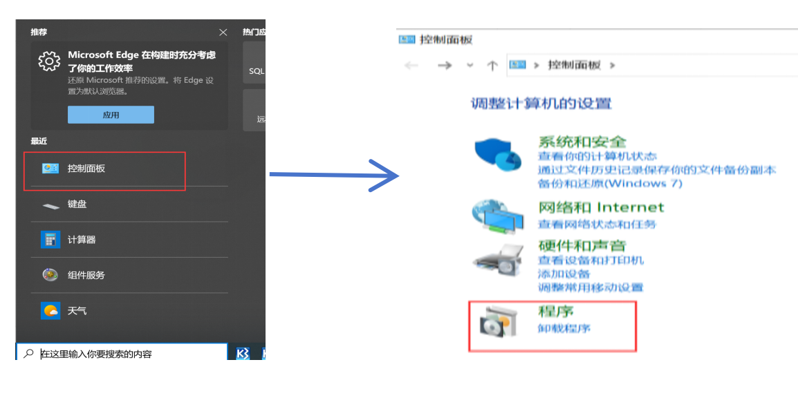
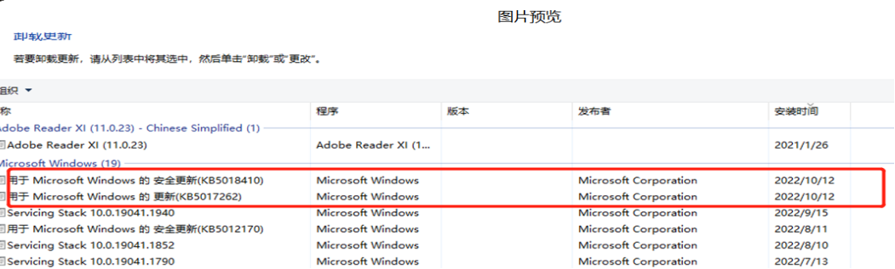
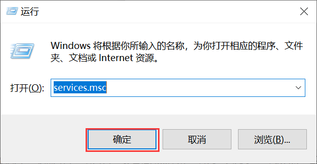
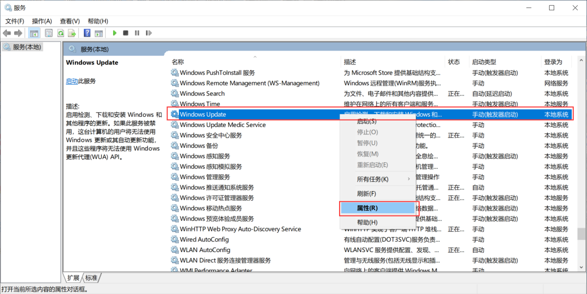
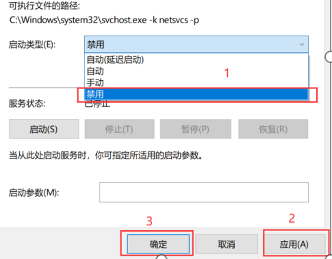
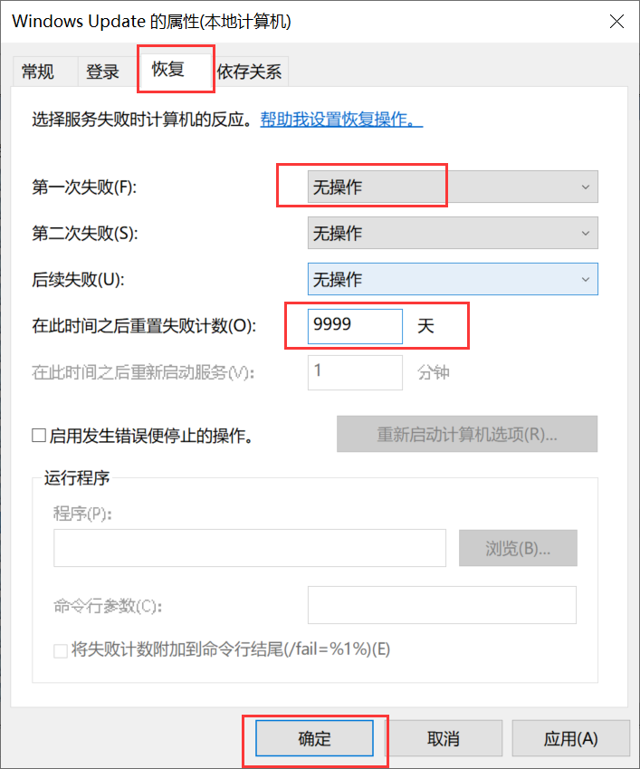
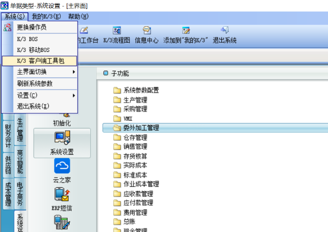
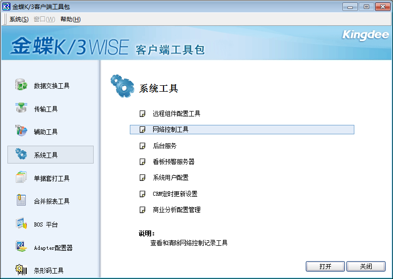
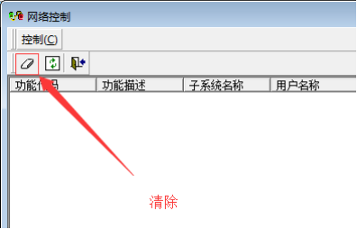

---
title: 'ERP常见故障处理'
date: "2024-04-02"
author:
  - 信息中心
output: 
  rticles::ctex:
    toc: true
# subtitle: '以 PDF 输出为例'
keywords:
  - ERP 故障
# abstract: >
# fontsize: "10pt"
# papersize: "a5"
# geometry: "margin=1in"
# biblio-title: 参考文献
# bibliography: skeleton.bib
# link-citations: yes
# # documentclass: ctexart

--- 
<GlobalComponent/>

### 一、点击K3，出现“无法创建K/3中间层组件，请确定中间层组件配置正确或当前用户拥有相关权限后重试”问题。

::: danger 
原因：电脑更新了微软的补丁，要把微软补丁卸载了重启电脑后才可以恢复正常。
:::

解决此问题需要管理员权限才可以操作。可以联系IT Hotline，让IT Hotline人员根据下述步骤操作： 
1、打开“控制面板”-->然后找到“程序”； 

2、查看已安装的更新，找到两个补丁KB5018410,KB5017262然后将其卸载； 

3、卸载完成之后需要将Windows更新“禁用”。 

### 二、K3使用过程中遇到BOS用户冲突问题
1、在金蝶左上角: 【系统】-----> 【K/3客户端工具包】 

2、然后选择【系统工具】----->【网络控制工具】 

3、然后点击【清除】 

