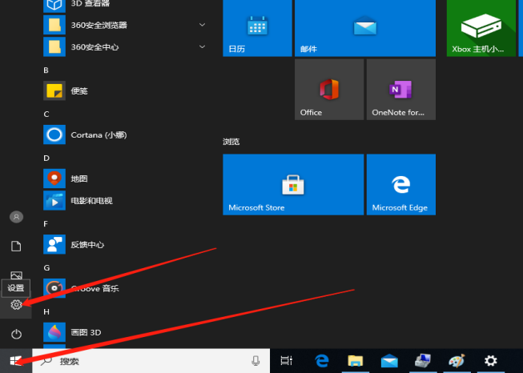
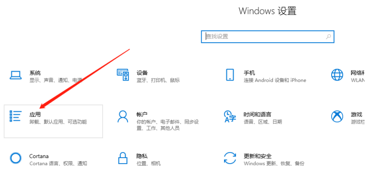
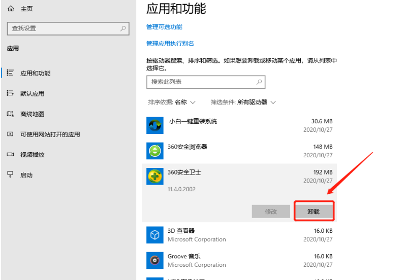
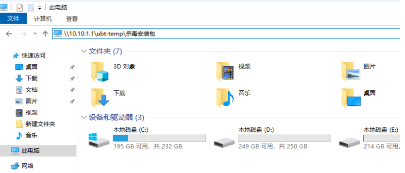
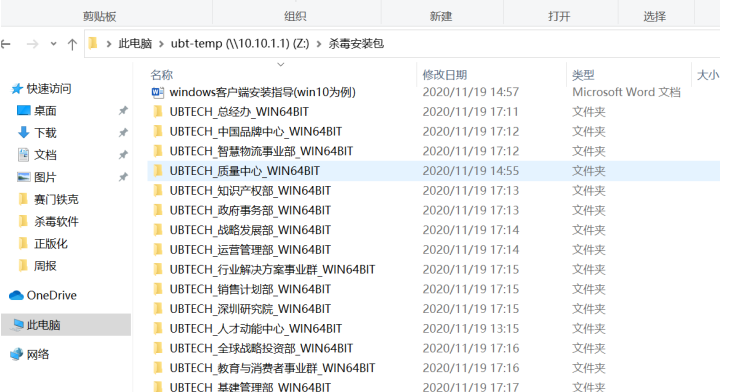
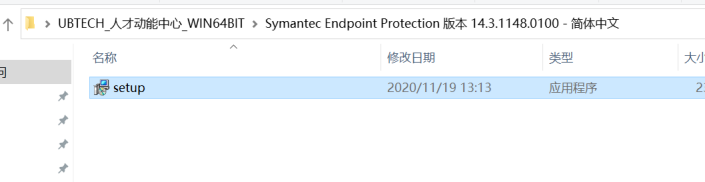
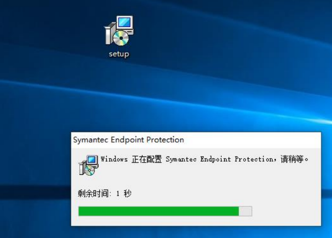
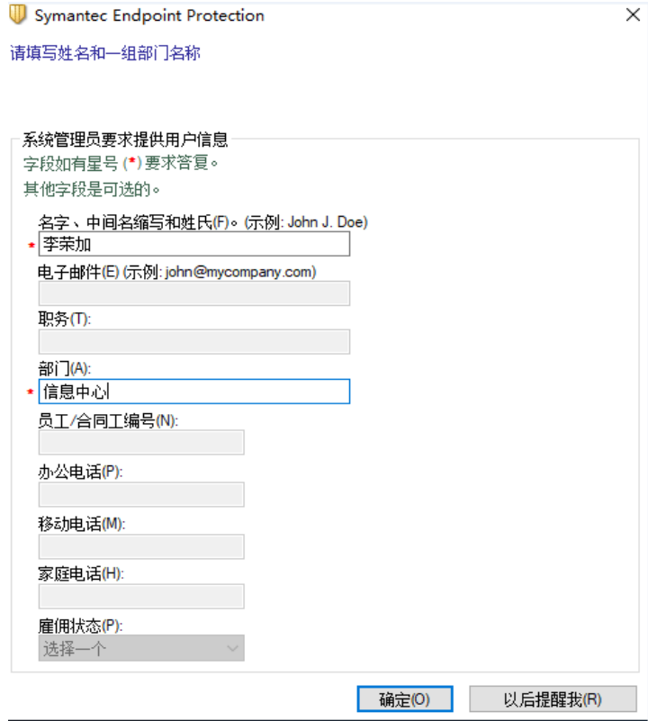
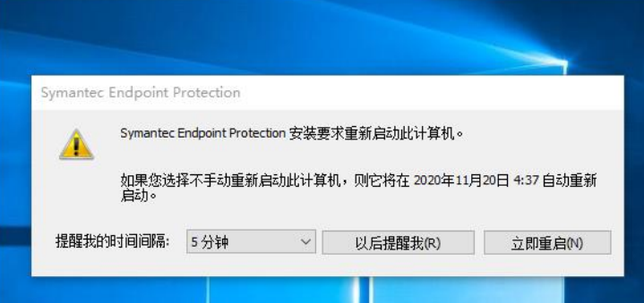

---
title: '杀毒软件安装指引　'
date: "2024-04-24"
author:
  - 信息中心
output: 
  rticles::ctex:
    toc: true
# subtitle: '以 PDF 输出为例'
keywords:
  - 杀毒软件
# abstract: >
# fontsize: "10pt"
# papersize: "a5"
# geometry: "margin=1in"
# biblio-title: 参考文献
# bibliography: skeleton.bib
# link-citations: yes
# # documentclass: ctexart

--- 
<GlobalComponent/>

## 客户端安装指导 
### 第一步：卸载原来的防护工具
卸载电脑原来安装的 360 卫士、电脑管家等，按下列图片步骤（开始—设置—应用）进行卸载

### 第二步：安装 Symantec 客户端
１．下载安装包：打开此电脑，地址栏中输入共享盘路径：\\10.10.1.1\ubt-temp\杀毒安装包找到自己部门名称的安装包文件夹（例如人才动能中心的员工找到 UBTECH_人才动能中心_WIN64BIT 文件夹） 

2．打开文件夹找到里面的 setup，复制到自己的本地电脑上，双击 setup 进行安装 

3．填写信息：按提示填写部门和姓名，确定。 

４．立即重启电脑或者延时重启电脑，安装完毕 
