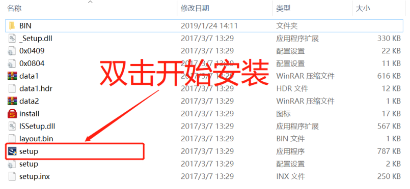
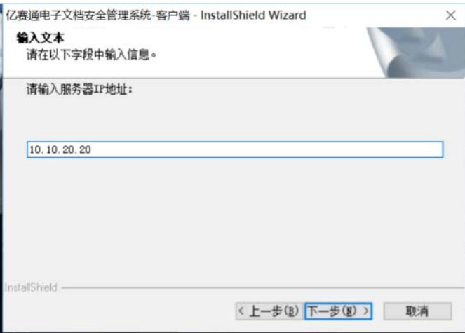
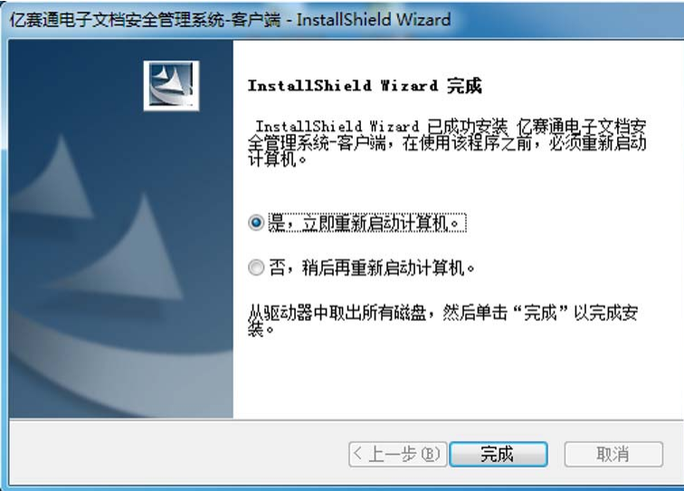
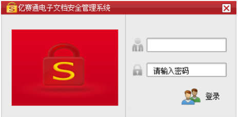
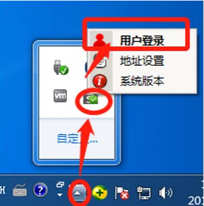
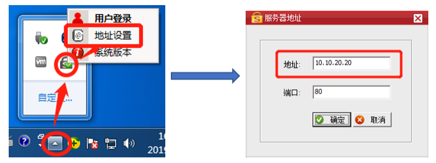
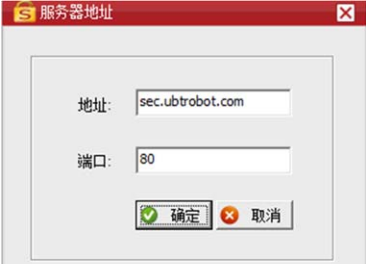
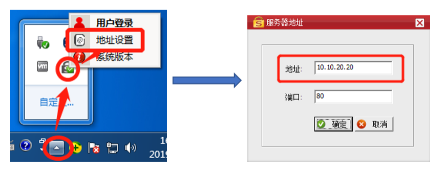
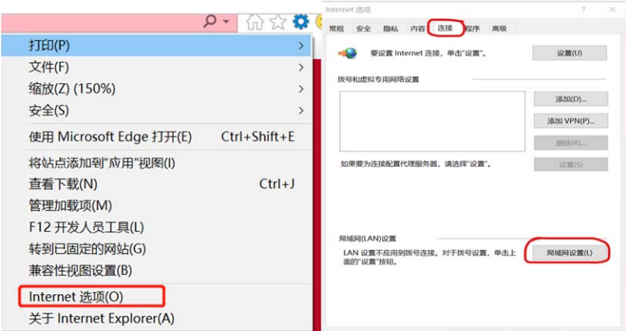
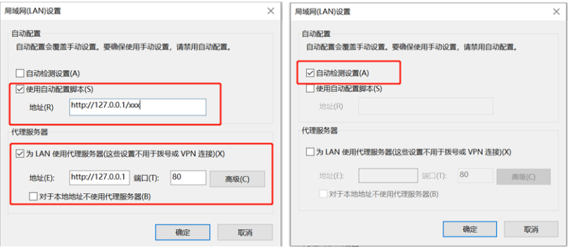

---
title: '加密客户端使用指南 '
date: "2024-04-24"
author:
  - 信息中心
output: 
  rticles::ctex:
    toc: true
# subtitle: '以 PDF 输出为例'
keywords:
  - 加密
# abstract: >
# fontsize: "10pt"
# papersize: "a5"
# geometry: "margin=1in"
# biblio-title: 参考文献
# bibliography: skeleton.bib
# link-citations: yes
# # documentclass: ctexart

--- 
<GlobalComponent/>
1、加密客户端使用过程中若发现新类型的文件无法通过开发工具或者开发工具无法打开加密文件，则联系加密管理员进行策略调整。 
2、加密会话到期：
使用过程中发现可以打开的文件无法法打开，任务栏右下角加密图标,显示此类图标，
或者点击图标显示“脱机异常”，则表示登录过期了需要重新登录；
或没有任何显示也无法打开以前可以打开的文件了，也有可能是登录会话过期了需要重新登录，目前的版本重新登录需要通过更改【地址配置】。 
3、地址配置更改： 
右键图标【地址配置】，若目前的地址配置为10.10.20.20则更改为sec.ubtrobot.com，若使用的是sec.ubtrobot.com则更改为10.10.20.20，两个地址可以相互切换使用，但仅限于内网。 
4、加密软件目前仅限于内网访问，若如果需要出差超过3天时间或者出差期间需要解密审批，则需要连到内网来处理。 

<!-- ### 一、软件安装 

  <strong>安装加密软件前的注意事项：</strong>
  请务必确保电脑上没有安装 360、鲁大师、百度云盘/网盘等第三方非公司授权使用的杀毒软件、网络共享盘软件或性能检测工具等，若有安装可能会导致加密软件无法正常工作。 
 

1、打开解压后的文件夹，双击文件夹中的 setup 应用程序开始安装。 

2、加密软件的安装过程中不需要用户做其他设置，直接点击“下一步”即可。在下图界面要求输入
<strong>服务器 IP 地址时，请设置为 sec.ubtrobot.com，若一直在内网使用可以直接输入 10.10.20.20</strong>，然后继续点击“下一步”继续安装。 

3、安装过程之后，弹出重启计算机提示。请关闭打开的应用程序，保存相应的文件之后重启计算机完成安装。 

4、重启计算机之后，一般情况下会自动弹出登录提示界面。输入自己的帐号密码，点击登录即可（OA 帐号密码默认 1 到 8，登录之后请及时更改初始密码）。
  
<strong>其它说明：</strong>部分人员可能安装完成之后无法正常登录，请按照以下说明先简单排除一下问题：  
（1）没有加密软件的登录界面弹出，请查看桌面右下角区域，包括隐藏图标，找到一个灰色锁标示的图标，右键点击弹出菜单，点击【用户登录】即可看到用户登录界面，然后登录即可。  
  
（2）登录过程提示“用户名或密码错误”，该提示有两种情况：第一种是在安装软件过程中未正确输入服务器 IP 或者域名，请按照下图重新设置服务器地址。第二种是用户名和密码输入错误，请直接使用企业微信联系信息中心核对帐号密码信息。   
  
或者   
（3）如有任何问题可咨询信息中心协调处理，谢谢！ 

### 二、日常使用 
#### 1、如何解密？ 
+ 右击文件，众多选项中选择【申请解密】
+ 若无此项，请确定登录是否正常，网络连接是否正常，是否有安装各类游戏软件，360 等杀毒软件，各类性能检测工具等。
+ 若各种情况都不存在，请联系信息中心调查处理。 
#### 2、登录显示脱机登录 
+ 加密软件登录有时间限制，使用一段时间之后需要重新登录。
+ 若任务栏的图标显示有横杠 ，或者点击图标显示“脱机异常”，则表示登录过期了需要重新登录。修改地址配置，将当前的地址配置更改为 sec.ubtrobot.com 或者 10.10.20.20，之后再改回原来的配置。
+ 若无法更改请确认浏览器是否有启用代理。 
+ 更改完地址配置之后就可以点击用户登录重新登录客户端，若登录之后还显示脱机异常，可重启或者检查网络是否不稳定。 

#### 3、检查浏览器是否开启代理的步骤 
IE 浏览器为例：设置—>Internet 选项（O）—>连接—>局域网设置—>若打开局域网设置之
后看到“☑使用自动配置脚本(S) ”或者“  ☑为 LAN 使用代理服务器(这些设置不用于拨号或
VPN 连接)(X)”已勾选，则表示启用了代理，这两项都不可以选，若只选择了“☑自动检测
设置(A)” 则表示没有启用代理。若使用多个浏览器，尽量只使用 Chrome 或者微软的 Edge，
不要使用搜狗，360 等浏览器。

 -->