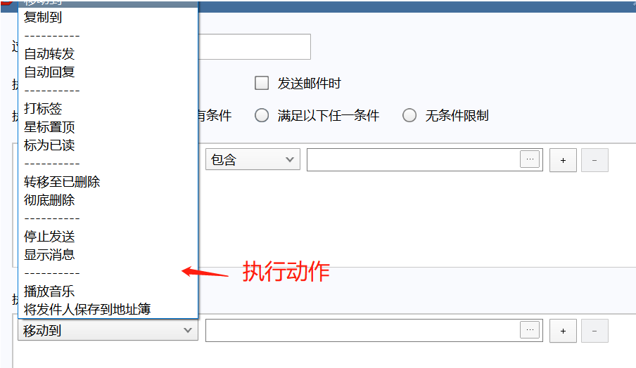
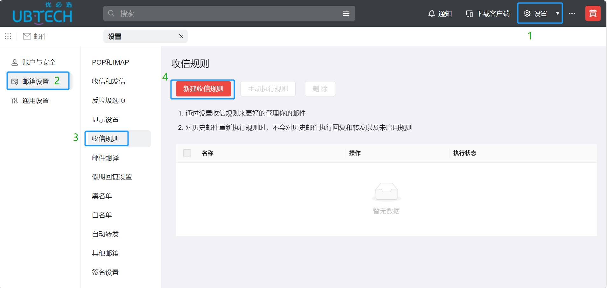
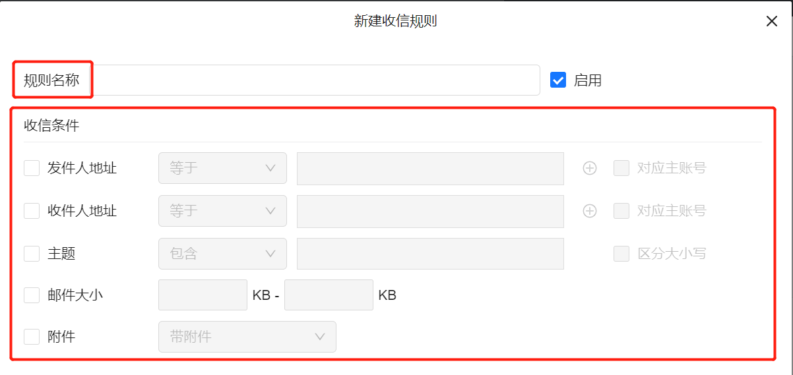
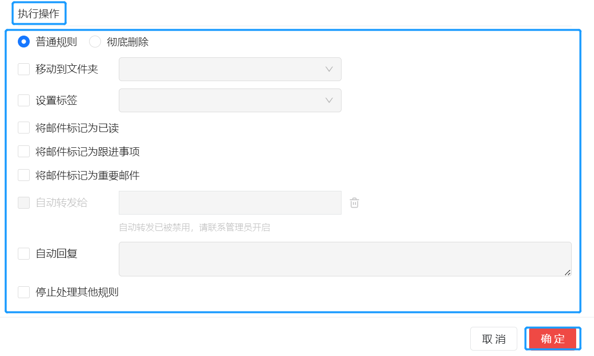
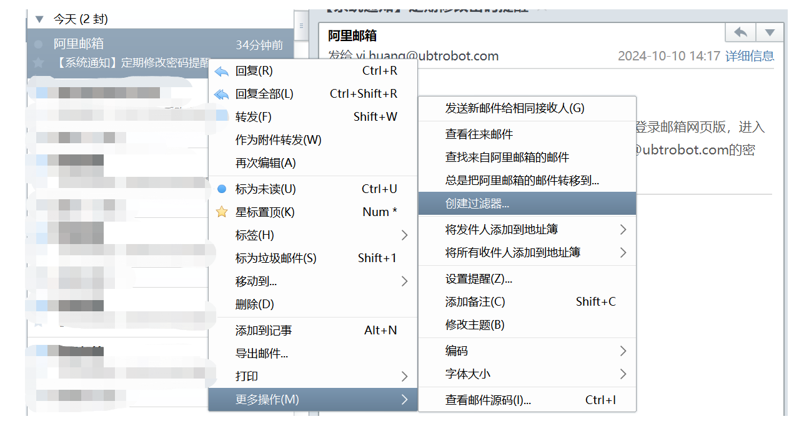

---
title: '邮箱操作指南'
date: "2024-04-02"
author:
  - 信息中心
output: 
  rticles::ctex:
    toc: true
# subtitle: '以 PDF 输出为例'
keywords:
  - 邮箱
# abstract: >
# fontsize: "10pt"
# papersize: "a5"
# geometry: "margin=1in"
# biblio-title: 参考文献
# bibliography: skeleton.bib
# link-citations: yes
# # documentclass: ctexart

--- 
<GlobalComponent/>

<!-- # 邮箱登录篇 -->
>若网页登录页面的操作步骤出现空白页，即浏览器禁用了网页跳转，可选择更换另一个浏览器尝试，或者调整浏览器页面跳转设置。
 
### 一、网页端登录
点击以下任何一个链接即可跳转到阿里邮箱登录页面 
<https://qiye.aliyun.com/alimail/auth/login?reurl=%2Falimail%2F> 
<http://mail.ubtrobot.com/alimail/>
### 二、客户端登录（包括Foxmail/Outlook/企业微信等其它非阿里云邮箱客户端）
<strong>1、登录需设置第三方客户端登录密码。</strong> 
（注：网页登录密码和<strong>第三方客户端安全密码</strong>是不同的密码。） 
（除阿里云客户端外，其他客户端如Foxmail/Outlook/企业微信/应用程序中设置邮箱自动发送等都需要使用<strong>第三方客户端安全密码</strong>） 
>ps：如果配置企业微信里的邮箱时显示如图的情况，则需要配置下述的第三方客户端安全密码
 

①登录网页版邮箱，选择<strong>设置->帐户与安全->帐户安全->第三方客户端安全密码</strong>，启用第三方客户端安全密码 
（若还使用旧版本Web邮箱则无法查看到相关选项，需在首页切换新版本。）

<!-- >确认第三方客户端安全密码已启用 -->
::: danger 
确认第三方客户端安全密码已启用
:::
 
②点击生成新密码->安全手机验证->获取动态密码->输入动态码后点击确定。
 
③点复制新生成的密码->输入设备名称->点确定。
 
 

> 若如果企业微信上无法使用此密码登录，则可以再生成一个新的【三方客户端安全密码】，设备可以写为【手机】。

④将复制的密码粘贴至Outlook/Foxmail/企业微信登录邮箱的<strong>密码框</strong>，即可使用三方客户端安全密码登录。 
<strong>foxmail初始设置：</strong> 
客户端点击 <strong>账号管理->账号->添加账号->其他邮箱->输入地址和上方生成的【三方客户端安全密码】->输入IMAP服务器地址和SMTP服务器地址。</strong> 

 

 
<strong>foxmail账号已添加：</strong> 
可直接在<strong>账号管理->账号->设置下粘贴上方生成的【三方客户端安全密码】</strong>，或者<strong>点击【收取】邮件之后在弹框的密码里输入【三方客户端安全密码】。</strong>
+ 法一：可在账号管理→账号→设置粘贴上方生成的【三方客户端安全密码】 
 
+ 法二：可直接点击【收取】邮件之后再弹窗里输入【三方客户端安全密码】 
 
<strong>公共邮箱：</strong> 
有些公共邮箱用在应用程序中自动发送邮件也需要生成【三方客户端安全密码】登录使用才能正常在应用程序中发送邮件。 
操作步骤参考上方设置，不再赘述。

<!-- ### 03、强密码设置
为了保障邮箱密码不会被暴力破解导致盗号，请设置强密码，强密码设置可以参考此网站：<https://1password.com/zh-cn/password-generator/> -->

### 三、垃圾/钓鱼邮件处理
1、凡是提到联系邮箱管理员或者信息中心管理员的，除非您明确知道是来自postmaster地址的，其他不确定的请私聊IT Hotline或信息中心的同事。来自内部邮箱发送的邮件也未必是安全的邮件，也存在盗号发送钓鱼邮件的情况。以下是一些示例，发件地址有来自外部和来自内部的，因此大家务必提高警惕和安全意识！ 
 
 
 
2、如果你收到垃圾邮件/钓鱼邮件，一定要登录网页版去举报垃圾邮件/钓鱼邮件，邮箱的拦截规则需要靠大家频繁举报来提高过滤规则。旧版本只有举报的选项，所以需要切换到新版本，如果目前使用的是新版本则无需理会。 
 
然后选中对应的垃圾邮件或钓鱼邮件，不需要打开邮件，选中邮件之后右键即可看到举报垃圾邮件/举报钓鱼邮件的选项。 
 
+ 如果是外部的地址，举报时将发件地址拉入黑名单。 
 
+ 若如果是盗用内部邮箱账号发送的邮件，不要将地址拉入黑名单，拉入黑名单之后您以后可能都无法收到TA所发的邮件了。 
 

### 四、设置邮箱收信规则
>过滤器是一种可以由您自己设定条件，根据不同条件（邮件发送时间、邮件主题等）实现自动处理邮件的功能（又称收信规则）。

1、打开foxmail主界面后按图下点击，进入过滤器管理界面。 
<!--  -->
 
2、新建邮箱规则
选择过滤器应用的邮件账号，然后选择右侧菜单中“新建”，设置过滤器要求
<!--  -->
 
3、新建过滤器规则
新建过滤器规则，如下图所示，可选择设置过滤器的名称，选择执行时机、执行条件、执行动作，设置完成，点击确定。 
<!--  -->
 
其中，执行时机的选择取决于您的过滤器设置是应用于收取邮件时还是发送邮件时 
执行条件可以选择过滤器的筛选标准，比如收件人地址、邮件主题、时间等等。如下图所示： 
执行动作可以选择你将过滤的邮件的处置方式，比如移动、复制、删除到已删除邮件、垃圾邮件等动作。 
<!--  -->
 

4、执行过滤器规则
确定过滤器规则以后，可以选择立即执行，也可以选择下次在收信的时候执行。

### 附录: 网页端设置邮箱收信规则
1、登录网页端邮箱，选择页面右上方的设置，跳转到邮箱设置页面，选择【收信规则】 
 
2、如下图所示，可选择设置过滤器的名称、收信条件，选择执行时机、执行条件、执行动作，设置完成，点击右下角的【确定】。 
 
 

### 附录:单个邮箱址快速创建规则 
如下图所示，右键选择要操作的邮件，选择更多操作，选择“创建过滤器”，然后对其设置邮件的过滤器规则。 

<!--  -->
 

::: tip
关于邮箱操作的其他疑问可在企业微信通讯录【员工服务】->IT Hotline  直接咨询； 
或直接访问阿里云官方的帮助文档参考: <https://help.aliyun.com/document_detail/438661.html?spm=a2c4g.442473.0.0.47dd276dgMqWAK>
:::
