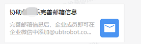
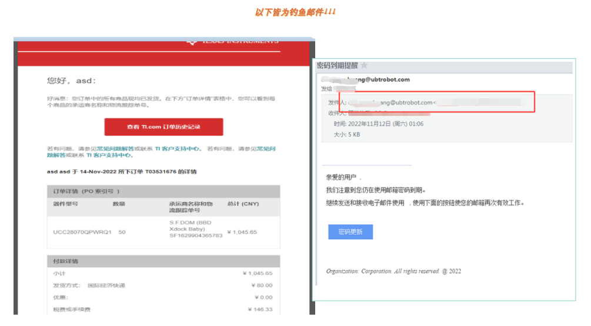
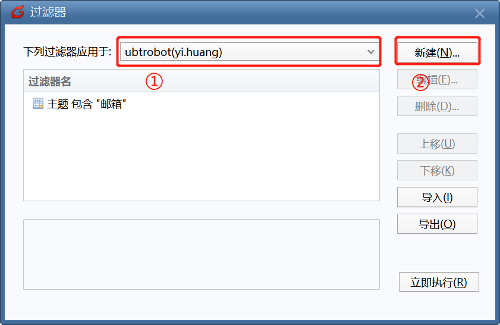
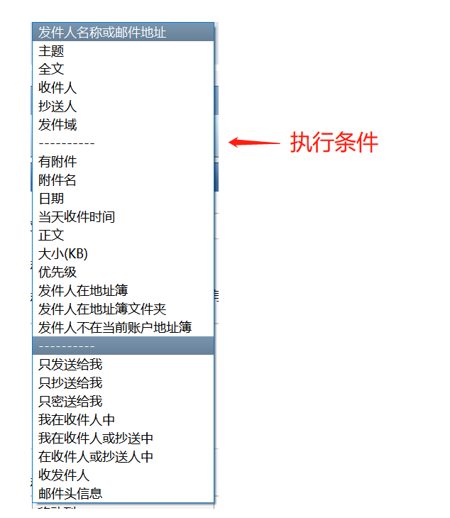
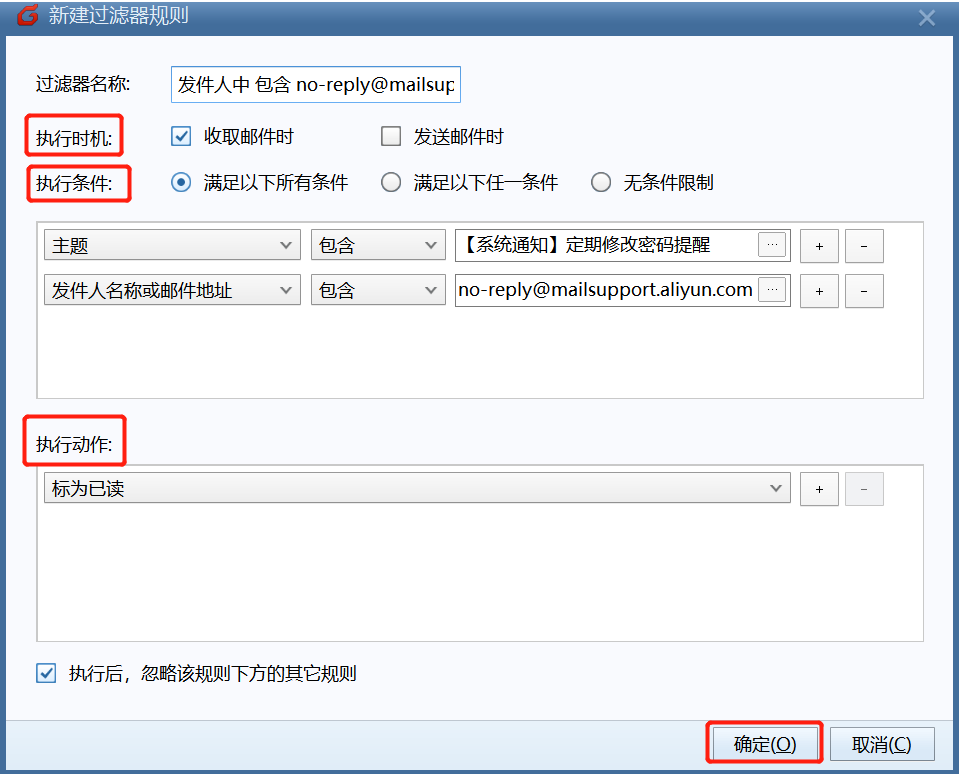

title: '邮箱操作指南'
date: "2024-04-02"
author:
  - 信息中心
output: 
  rticles::ctex:
    toc: true
# subtitle: '以 PDF 输出为例'
keywords:
  - 邮箱
# abstract: >
# fontsize: "10pt"
# papersize: "a5"
# geometry: "margin=1in"
# biblio-title: 参考文献
# bibliography: skeleton.bib
# link-citations: yes
# # documentclass: ctexart
<GlobalComponent/>
<!-- # 邮箱登录篇 -->

一、网页端登录
点击以下任何一个链接即可跳转到阿里邮箱登录页面

https://qiye.aliyun.com/alimail/auth/login?reurl=%2Falimail%2F

http://mail.ubtrobot.com/alimail/
二、客户端登录（包括Foxmail/Outlook/企业微信等其它非阿里云邮箱客户端）
<strong>

<strong>是不同的密码。）

（除阿里云客户端外，其他客户端如Foxmail/Outlook/企业微信/应用程序中设置邮箱自动发送等都需要使用<strong>）
ps：

①登录网页版邮箱，选择<strong>，启用第三方客户端安全密码

（若还使用旧版本Web邮箱则无法查看到相关选项，需在首页切换新版本。）
<!-- >确认第三方客户端安全密码已启用 -->
::: danger

:::

②点击生成新密码->安全手机验证->获取动态密码->输入动态码后点击确定。

③点复制新生成的密码->输入设备名称->点确定。

若如果企业微信上无法使用此密码登录，则可以再生成一个新的【三方客户端安全密码】，设备可以写为【手机】。
④<strong>，即可使用三方客户端安全密码登录。

<strong>

客户端点击 <strong>

<strong>

可直接在<strong>，或者<strong>
法一：可在账号管理→账号→设置粘贴上方生成的【三方客户端安全密码】

法二：可直接点击【收取】邮件之后再弹窗里输入【三方客户端安全密码】

<strong>

有些公共邮箱用在应用程序中自动发送邮件也需要生成【三方客户端安全密码】登录使用才能正常在应用程序中发送邮件。

<!-- ### 03、强密码设置
为了保障邮箱密码不会被暴力破解导致盗号，请设置强密码，强密码设置可以参考此网站：<https://1password.com/zh-cn/password-generator/> -->
三、垃圾/钓鱼邮件处理
1、凡是提到联系邮箱管理员或者信息中心管理员的，除非您明确知道是来自postmaster地址的，其他不确定的请私聊IT Hotline或信息中心的同事。来自内部邮箱发送的邮件也未必是安全的邮件，也存在盗号发送钓鱼邮件的情况。以下是一些示例，发件地址有来自外部和来自内部的，因此大家务必提高警惕和安全意识！

2、旧版本只有举报的选项，所以需要切换到新版本，如果目前使用的是新版本则无需理会。

然后选中对应的垃圾邮件或钓鱼邮件，不需要打开邮件，选中邮件之后右键即可看到举报垃圾邮件/举报钓鱼邮件的选项。

如果是外部的地址，举报时将发件地址拉入黑名单。

若如果是盗用内部邮箱账号发送的邮件，不要将地址拉入黑名单，拉入黑名单之后您以后可能都无法收到TA所发的邮件了。

四、设置邮箱收信规则
过滤器是一种可以由您自己设定条件，根据不同条件（邮件发送时间、邮件主题等）实现自动处理邮件的功能（又称收信规则）。
1、打开foxmail主界面后按图下点击，进入过滤器管理界面。
<!--  -->

2、新建邮箱规则
选择过滤器应用的邮件账号，然后选择右侧菜单中“新建”，设置过滤器要求
<!--  -->

3、新建过滤器规则
新建过滤器规则，如下图所示，可选择设置过滤器的名称，选择执行时机、执行条件、执行动作，设置完成，点击确定。
<!--  -->

<!--  -->

4、执行过滤器规则
确定过滤器规则以后，可以选择立即执行，也可以选择下次在收信的时候执行。
附录: 网页端设置邮箱收信规则
1、登录网页端邮箱，选择页面右上方的设置，跳转到邮箱设置页面，选择【收信规则】

2、如下图所示，可选择设置过滤器的名称、收信条件，选择执行时机、执行条件、执行动作，设置完成，点击右下角的【确定】。

附录:单个邮箱址快速创建规则
如下图所示，右键选择要操作的邮件，选择更多操作，选择“创建过滤器”，然后对其设置邮件的过滤器规则。

<!--  -->

::: tip
关于邮箱操作的其他疑问可在企业微信通讯录 直接咨询；

或直接访问阿里云官方的帮助文档参考:

:::
