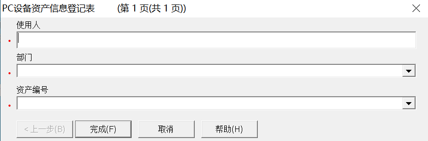
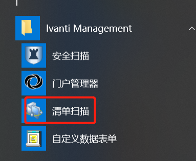

---
title: '桌管软件自定义数据表单更新'
date: "2024-04-24"
author:
  - 信息中心
output: 
  rticles::ctex:
    toc: true
# subtitle: '以 PDF 输出为例'
keywords:
  - 桌管 
# abstract: >
# fontsize: "10pt"
# papersize: "a5"
# geometry: "margin=1in"
# biblio-title: 参考文献
# bibliography: skeleton.bib
# link-citations: yes
# # documentclass: ctexart

--- 
<GlobalComponent/>

1、桌管软件仅适用于 Mac 和 Windows 操作系统。 
2、点击“开始”-->"程序"-->"Ivanti Management"-->"自定义数据表单"-->填写“使用人名、部门、电脑资产编号”，点击“完成”，部门请输入一级加二级部门比如“多元化事业部-产品部”。 
 
3、注册完成后，点击“开始”-->"程序"-->"Ivanti Management"-->“清单扫描”，同步资产信息，便于查找和IT远程协助处理电脑问题。 
 