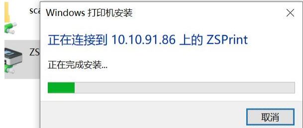

---
title: '新打印机添加和配置'
date: "2024-04-24"
author:
  - 信息中心
output: 
  rticles::ctex:
    toc: true
# subtitle: '以 PDF 输出为例'
keywords:
  - 打印机
# abstract: >
# fontsize: "10pt"
# papersize: "a5"
# geometry: "margin=1in"
# biblio-title: 参考文献
# bibliography: skeleton.bib
# link-citations: yes
# # documentclass: ctexart

--- 
<GlobalComponent/>

### 一、添加打印机: 
1 、打开我的电脑（或计算机），搜索框输入\\\\10.10.91.86 并回车后双击 ZSPrinter 打印机添加
 
 
 
第二种方式:通过脚本连接打印机 
右键保存下方脚本另存为: add-print-new.bat
<GlobalComponent2/>
双击执行 
 

### 二、配置打印机: 
1 、打开我的电脑（或计算机），通过资源管理器访问如下地址并回车 \\\\10.10.91.86，双击 ZSPrint 
 

2、选择打印首选项 
 
3、选择详细的设置 
 
4、选择作业设置 
 
5、点击验证 
 
6、输入用户名后点击确认即可 
 
7、点击确定后退出 
 

