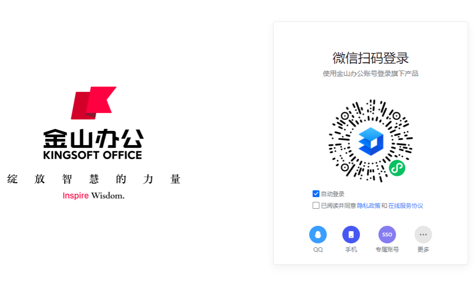
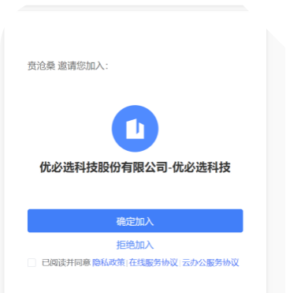
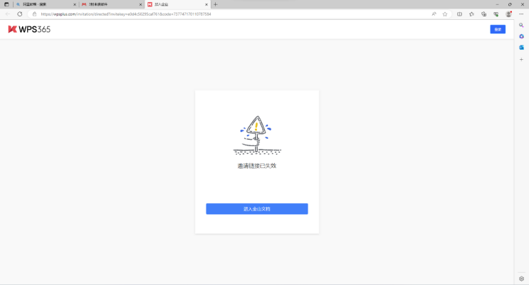
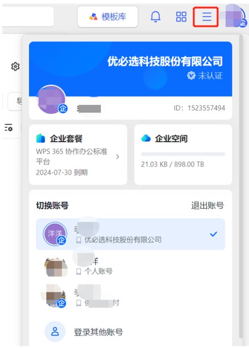
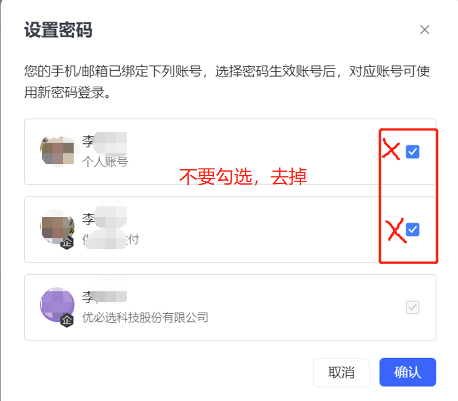
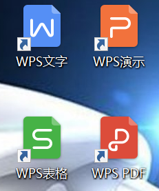
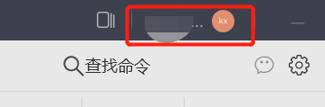

---
title: 'WPS Ofiice操作指南'
date: "2024-05-13"
author:
  - 信息中心
output: 
  rticles::ctex:
    toc: true
# subtitle: '以 PDF 输出为例'
keywords:
  - WPS
# abstract: >
# fontsize: "10pt"
# papersize: "a5"
# geometry: "margin=1in"
# biblio-title: 参考文献
# bibliography: skeleton.bib
# link-citations: yes
# # documentclass: ctexart

--- 
<GlobalComponent/>
<!-- ::: tip
WPS 激活有两种类型： 
一、激活码激活； 
二、账号登录激活，账号登录激活在收到激活链接后可参照以下操作步骤执行； 
:::  -->
>WPS 激活有两种类型： 
一、激活码激活； 
二、账号登录激活，账号登录激活在收到激活链接后可参照以下操作步骤执行； 

1）先参考下述的步骤了解如何激活WPS，然后去邮箱点击WPS的邀请链接/激活链接，点击链接登录之后【加入企业】，若打开链接一直转无法打开如下步骤的页面，则把链接复制到另外一个浏览器试试，若如果还不行则联系IT同事或者换个网络试试； 
2）点击邀请/激活链接后可以通过手机号码&验证码登录网页，或者微信扫码登录，扫码登录之后【加入企业】，【加入企业】之后在类似上图的界面可以看到账号已登录。别扫此文档贴图的所有二维码！！！ 

 
或者需要填写真实姓名和手机号码之后才可以加入到企业 
 
3）点击邮件【加入企业】后可能会显示下图，之后点击【进入金山文档】然后点击登录，或者直接点击右上角的【登录】，通过手机号码&验证码登录网页，登录成功后可以看到企业信息。 
 
4）登录之后可以看到企业名字，然后点击红色框的选项找到【个人中心】，进入【个人中心】之后找到【设置密码】，设置的密码需要和你个人账号的密码不一样，不然登录时可能会直接登录个人账号，而不会登录企业账号。设置密码时务必只勾选企业账号，个人账号不要勾选。 

 
5）设置完密码之后登录本地的WPS客户端（如下图），双击打开其中任一软件都可以。进去之后右上角有【未登录】选项，点击之后选择【WPS账号】，然后用手机号码和刚刚设置的密码登录，登陆时不要选择个人账号，登录之后点击账号查看是否登录的是企业账号，如果是企业账号则可以看到企业名称。如果没有显示企业信息的则为个人账号，需要重新登录，在登录时不要选择个人账号！！！ 

 
6）后续若发现突然无法使用WPS了，通过上述步骤设置的手机号码和密码重新登录下即可。

<!-- ### ①邮件点击WPS的邀请链接
  点击链接登录之后【加入企业】，若打开链接一直转，无法打开以下步骤的页面，则把链接复制到另外一个浏览器试试，若如果还不行则联系IT同事或者换个网络试试； 
+ 点击邮件【加入企业】后可能会显示下图，选择【进入金山文档】然后点击【登录】； 
+ 或者直接点击右上角的【登录】，然后通过【手机号码&验证码】登录网页，登录成功后可以看到企业信息。 
  
### ②登录
点击邀请/激活链接后，登录网页可以通过【手机号码&验证码】登录，或者【微信扫码】登录，登录之后点击【加入企业】，之后在类似上图的界面可以看到账号已登录。 
注意：此文档贴图的所有二维码仅作为案例，不要扫！！！ 
      
      

### ③设置账户密码
登录WPS之后可以看到企业名字，点击下图右上方红色框圈中的选项找到【个人中心】，点击进入【个人中心】，找到【设置密码】，设置的密码需要和你个人账号的密码不一样，不然登录时可能会直接登录个人账号，而不会登录企业账号。
【ps：设置密码时务必只勾选企业账号，个人账号不要勾选。】 
  
  

### ④打开WPS软件
重置完密码之后登录本地的WPS客户端（如下图），双击打开其中任一软件都可以。
在登录时不要选择个人账号！！！ 
进去之后右上角有【未登录】选项，点击选择【WPS账号】，然后用手机号码和刚刚设置的密码登录，登陆时不要选择个人账号，登录之后点击账号查看是否登录的是企业账号，如果是企业账号则可以看到企业名称。如果没有显示企业信息的则为个人账号，需要重新登录 
  
  
   -->